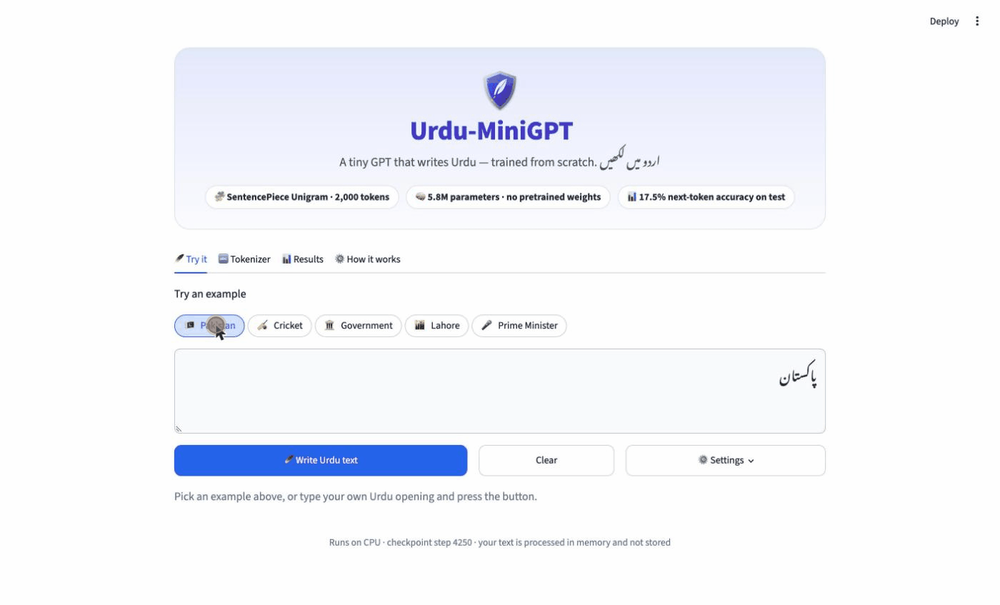
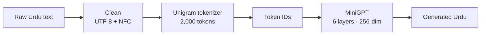

<div align="center">


# Urdu-MiniGPT

**A tiny GPT that writes Urdu, trained from scratch.**

SentencePiece Unigram tokenizer (2,000 tokens) + a decoder-only Transformer written in PyTorch. No pretrained weights.

🚀 **[Live demo](https://urdu-minigpt.streamlit.app)** · 📄 **[Read the full report (PDF)](report/report.pdf)**


[](https://urdu-minigpt.streamlit.app)



</div>

## Overview



1. **Clean** – UTF-8, Unicode NFC normalisation, drop empty lines.
2. **Tokenize** – SentencePiece Unigram, `vocab_size=2000`, trained on the train split only.
3. **Encode** – train / val / test into token IDs, each document ending with `</s>`.
4. **Train** – causal self-attention, GELU MLP, pre-LayerNorm; AdamW with warmup + cosine LR and early stopping on val.
5. **Evaluate** – test set scored once: loss, perplexity, top-1 / top-5 next-token accuracy.

## Quick start

Requires Python 3.10+. A CUDA GPU trains the model in about 1 minute (CPU: ~50 minutes).

```bash
python -m venv .venv && source .venv/bin/activate
pip install torch sentencepiece numpy pytest
```

Run the pipeline from the project root:

```bash
python src/clean_data.py                # data/raw → data/clean
python src/train_tokenizer.py           # tokenizer/urdu_unigram.model
python src/encode_data.py               # data/encoded/*.npy
PYTHONPATH=src python src/train.py      # checkpoints/best.pt
PYTHONPATH=src python src/evaluate.py   # test loss + samples
PYTHONPATH=src python src/accuracy.py   # next-token accuracy
python -m pytest -q tests               # model sanity checks
```

Optional hyperparameter sweep (validation only):

```bash
PYTHONPATH=src python scripts/sweep.py
PYTHONPATH=src:scripts python scripts/sweep2.py
```

## Data

ALIF Urdu Corpus (news text), provided as `Urdu_MiniGPT_Dataset.zip` and split by document.

| Split | Documents | Tokens | Used for |
|---|---:|---:|---|
| train | 547 | 269,379 | tokenizer + model training |
| val | 81 | 34,362 | early stopping, model selection |
| test | 70 | 35,014 | final evaluation (once) |

## Results

Final model: 6 layers, 4 heads, 256-dim, context 128, dropout 0.3, weight decay 0.3 — **5.8M parameters**.

| Split | Loss | Perplexity | Top-1 acc | Top-5 acc |
|---|---:|---:|---:|---:|
| train | 3.219 | 25.0 | 31.0% | 56.4% |
| val | 4.728 | 113.1 | 18.1% | 38.0% |
| **test** | **4.822** | **124.3** | **17.5%** | **37.0%** |

From a 14-run sweep (chosen on val only):

- Regularisation mattered most — weight decay 0.3 and dropout 0.3 gave the largest gain.
- Larger models or a 256-token context overfit quickly on this small dataset.
- Tied embeddings hurt (about −4 points top-1).

Sample output:

```text
لاہور (فاردو پوائنٹ اخبارتازہ ترین اے پی پی پی) کے مطابق پاکستان کرکٹراد علی ثلا ہونے پر یہ بات ہے کہ
پاکستان کے بعد کیا گیا جبکہ ان کا ساتھ ہو گا۔ پاکستان کرکٹ بورڈ کے ساتھ ...
```

The model captures the news style but the meaning drifts — expected at this scale. Full results are in [`results/`](results/) and the [report](report/report.pdf).

## Streamlit app

```bash
cd streamlit_app
pip install -r requirements.txt
./sync_assets.sh      # copy tokenizer, best.pt and results into assets/
streamlit run app.py
```

Tabs: **Try it** (generate text), **Tokenizer** (view pieces and IDs), **Results** (metrics and training curve), **How it works**.

## Project structure

```
src/             data cleaning, tokenizer, model, training, evaluation
scripts/         data audits and hyperparameter sweeps
tests/           model tests
tokenizer/       trained SentencePiece model
data/            raw and cleaned text
results/         metrics, logs and samples
streamlit_app/   demo app
docs/            design notes
report/          LaTeX report
```

> Model checkpoints and encoded data are not tracked in git — run the pipeline to regenerate them.
